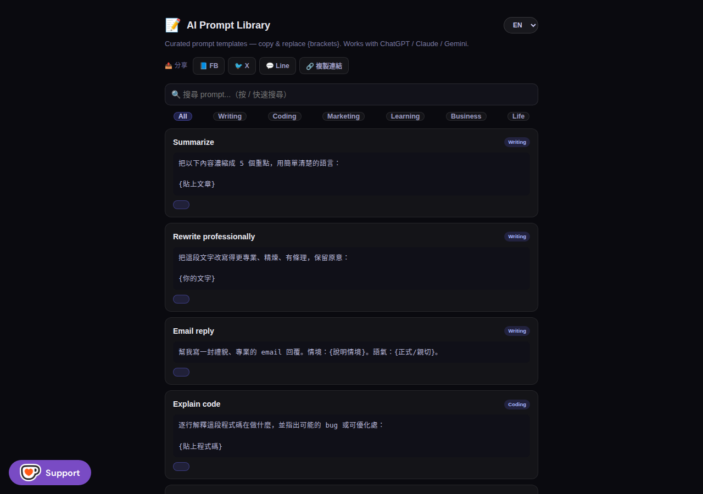

# 📝 AI Prompt Library — Free AI Prompt Templates

📬 Get AI tips & prompt templates — subscribe to the Slashman Tools newsletter: https://slashmantools.us/subscribe

> 500+ curated, copy-paste prompt templates for **ChatGPT / Claude / Gemini** — 100% free,
> no signup, runs entirely in your browser. This repo is the free tier of the
> [**AI Prompt 庫 ($29) — 500+ battle-tested premium templates**](https://slashmaster6.gumroad.com/l/diwoc?utm_source=github&utm_medium=readme&utm_campaign=ai-prompt-library)
> (Notion edition for marketing, coding, creation & productivity).

[](https://slashmantools.us/ai-prompt-library/?utm_source=github&utm_medium=readme&utm_campaign=ai-prompt-library)
[](LICENSE)
[]()
[]()
[](CONTRIBUTING.md)

---

## ✨ What is this?

A single-file, dependency-free **prompt template library** that works in any browser.
Unlike a blog post or PDF, it's an *interactive tool*:

- 🗂️ **Curated categories** — marketing, coding, writing, learning, business, productivity, and more
- 🔍 **Instant search + category filter** — find the right prompt in seconds
- 📋 **One-click copy** — click, paste, go
- 🌐 **Bilingual (EN / 繁體中文)** — toggle the UI language on the fly
- 🆓 **Free forever** — a single `index.html`, no build, no backend, no signup

**Why:** most "prompt collections" are dump-and-run lists of 1,000 random prompts.
This library is *curated* — every template is battle-tested, organized by use case, and
ready to copy. Use it as a daily driver or as a springboard for your own prompt engineering.

---

## 🖼️ Demo



**Try it live:** <https://slashmantools.us/ai-prompt-library/?utm_source=github&utm_medium=readme&utm_campaign=ai-prompt-library>

---

## 🚀 Quick start

Because it's a single HTML file, there's **zero setup**:

```bash
# Option 1: just open the hosted version
open https://slashmantools.us/ai-prompt-library/

# Option 2: run it locally
git clone https://github.com/slashman413/ai-prompt-library.git
cd ai-prompt-library
open index.html          # works on macOS
xdg-open index.html      # works on Linux
start index.html         # works on Windows
```

That's it — no `npm install`, no build step, no server. The entire app is one file.

### Use it in your own site

`index.html` is fully self-contained (inline CSS + JS + prompts data). Drop it into any
static host — GitHub Pages, Cloudflare Pages, Netlify — and it just works. The prompts
data lives at the bottom of the file as plain JSON, so you can extract it and embed it
anywhere.

---

## 🛍️ The full version

This free library is a taste of the real thing. The premium **AI Prompt 庫** ($29) on
Gumroad is a **Notion edition** with **500+ battle-tested templates** — organized by use
case, with real-world examples that actually work:

- 📈 Marketing & growth copy that converts
- 💻 Coding prompts (debugging, refactoring, code review)
- ✍️ Creation & writing (long-form, scripts, ideation)
- 🎯 Productivity & workflow automation

👉 **[Get the AI Prompt 庫 — 500+ premium prompts ($29)](https://slashmaster6.gumroad.com/l/diwoc?utm_source=github&utm_medium=readme&utm_campaign=ai-prompt-library)**

Also included in the **[AI Starter Bundle ($49)](https://slashmaster6.gumroad.com/l/lapcqb?utm_source=github&utm_medium=readme&utm_campaign=ai-prompt-library)**.

---

## 🧰 More free tools

Part of **[AI工具人 — Free Online Tools](https://slashmantools.us/tools/?utm_source=github&utm_medium=readme&utm_campaign=ai-prompt-library)** — a growing
collection of free AI, finance & productivity tools (中／EN):

| Tool | What it does |
|------|--------------|
| [AI Prompt Library](https://slashmantools.us/ai-prompt-library/?utm_source=github&utm_medium=readme&utm_campaign=ai-prompt-library) | This repo — free prompt templates |
| [AI Workflow Builder](https://workflow-builders.com/?utm_source=github&utm_medium=readme&utm_campaign=ai-prompt-library) | Prompt → validated multi-agent workflow (open source) |
| [More tools…](https://slashmantools.us/tools/?utm_source=github&utm_medium=readme&utm_campaign=ai-prompt-library) | Calculators, converters, dev tools & more |

---

## 📄 License

[MIT](LICENSE) © [slashman413](https://github.com/slashman413)

---

*Built by [@slashman413](https://github.com/slashman413) · [slashmantools.us](https://slashmantools.us/?utm_source=github&utm_medium=readme&utm_campaign=ai-prompt-library) · ☕ [Support on Ko-fi](https://ko-fi.com/ytstories0413)*